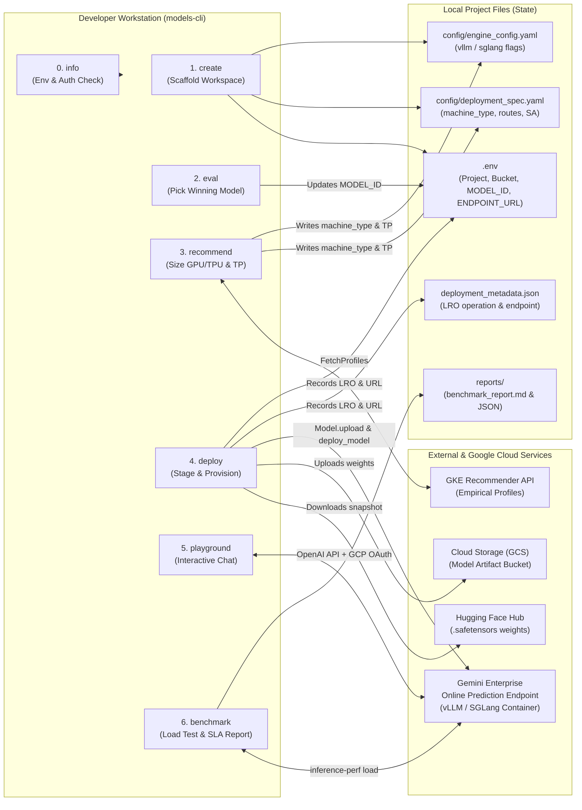
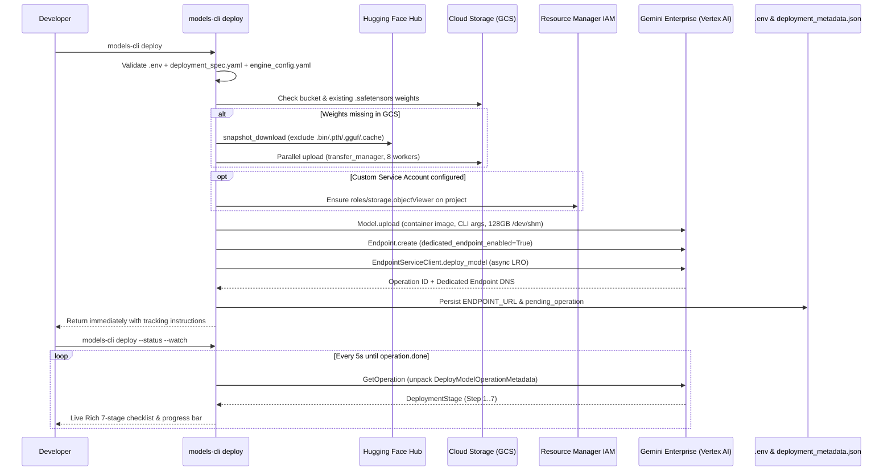

# `models-cli` (`google-models-cli`) — Complete Codebase Reference

> **How to Read This Document (Dual-Mode Guide)**
>
> Every major section in this reference is written in **two complementary modes**:
> 1. **🔬 Technical Deep Dive** — Written for software/ML engineers, SREs, and codebase contributors. Covers exact module paths, classes, API contracts, mathematical formulas, Protobuf/SDK internals, CLI architecture, and failure modes.
> 2. **🧭 Pragmatic Engineer's View** — Written for experienced engineers, architects, and technical leads who want a clear, common-sense understanding of *what* each piece does, *why* it was built that way, and *how* the pieces fit together operationally—without getting bogged down in Python or cloud SDK minutiae.

---

## Table of Contents

1. [Executive Overview](#1-executive-overview)
2. [System Architecture & End-to-End Lifecycle](#2-system-architecture--end-to-end-lifecycle)
3. [Technology Stack & External Integrations](#3-technology-stack--external-integrations)
4. [Codebase & Artifact Map](#4-codebase--artifact-map)
   - [4.1 Repository Source Artifacts](#41-repository-source-artifacts)
   - [4.2 Generated Workspace & Runtime Artifacts](#42-generated-workspace--runtime-artifacts)
5. [Core Functionalities (Command-by-Command Reference)](#5-core-functionalities-command-by-command-reference)
   - [5.1 `info` — Environment & Credential Diagnostics](#51-info--environment--credential-diagnostics)
   - [5.2 `create` — Workspace Scaffolding](#52-create--workspace-scaffolding)
   - [5.3 `eval` — Candidate Model Quality Evaluation](#53-eval--candidate-model-quality-evaluation)
   - [5.4 `recommend` — Hardware & Engine Optimization](#54-recommend--hardware--engine-optimization)
   - [5.5 `deploy` — Cloud Provisioning & Rollout Tracking](#55-deploy--cloud-provisioning--rollout-tracking)
   - [5.6 `playground` — Interactive Chat & Endpoint Testing](#56-playground--interactive-chat--endpoint-testing)
   - [5.7 `benchmark` — Load Testing & SLA Reporting](#57-benchmark--load-testing--sla-reporting)
6. [Cross-Cutting Infrastructure Subsystems](#6-cross-cutting-infrastructure-subsystems)
   - [6.1 CLI Framework & Lazy Loading](#61-cli-framework--lazy-loading)
   - [6.2 Configuration Hierarchy & Single-Source-of-Truth Design](#62-configuration-hierarchy--single-source-of-truth-design)
   - [6.3 Authentication & GCP Project Resolution](#63-authentication--gcp-project-resolution)
   - [6.4 Hardware Catalog & Container Runtime Architecture](#64-hardware-catalog--container-runtime-architecture)
7. [Notable Under-the-Hood Engineering Solutions](#7-notable-under-the-hood-engineering-solutions)
8. [Testing Architecture & Quality Assurance](#8-testing-architecture--quality-assurance)
9. [Current Limitations & Implementation Caveats](#9-current-limitations--implementation-caveats)

---

## 1. Executive Overview

### 🔬 Technical Deep Dive
`google-models-cli` (`v0.1.0`, Apache-2.0, Python `>=3.12`) is a namespace-packaged (`google.models.cli`) command-line toolchain exposing two console script entrypoints—`models-cli` and `models`. It orchestrates the full lifecycle of serving open-weights Large Language Models (e.g., Gemma, Llama, Qwen, DeepSeek, Kimi) on **Google Cloud Gemini Enterprise Online Prediction** (built atop the Vertex AI `aiplatform` / `aiplatform_v1` control and data planes) using pre-built **vLLM** and **SGLang** serving containers.

It unifies five traditionally fragmented cloud workflows behind a stateful workspace convention:
1. Project scaffolding (`create`)
2. Dataset-driven candidate ranking (`eval`)
3. Empirical hardware/engine sizing and custom token-profile interpolation via the **GKE Inference Quickstart API** (`recommend`)
4. SafeTensor weight staging to GCS, Model Registry upload, asynchronous dedicated Endpoint deployment, and LRO stage polling (`deploy`)
5. OpenAI-compatible streaming inference (`playground`) and `inference-perf` load generation (`benchmark`).

### 🧭 Pragmatic Engineer's View
Running open-source AI models (like Google's Gemma or Meta's Llama) on your own cloud infrastructure is attractive for cost control, privacy, and customization—especially when analyzing Total Cost of Ownership (TCO). However, actually doing it in production involves a painful obstacle course:
- *Which model size is good enough for our task?*
- *Which GPU or TPU machine should we rent so we don't overpay or run out of memory?*
- *How do we move 60+ GB of model files from Hugging Face into Google Cloud Storage?*
- *How do we configure complex inference servers (vLLM or SGLang) and wait 15–30 minutes for cloud hardware to spin up?*
- *Once it's live, how do we chat with it and prove it meets latency SLAs under real traffic?*

`models-cli` turns that multi-day glue-scripting exercise into a **single, guided 6-step terminal workflow**. Think of it like `terraform` + `docker-compose` + `ab` (ApacheBench), purpose-built for open-weights AI models on Google Cloud.

---

## 2. System Architecture & End-to-End Lifecycle



### 🔬 Technical Deep Dive
- **Loosely Coupled Commands via File-Backed State**: Commands do not pass in-memory state to one another. Instead, each command reads from and writes to deterministic workspace files (`.env`, `config/deployment_spec.yaml`, `config/engine_config.yaml`, and `deployment_metadata.json`), discovered by walking parent directories via `find_project_root()` in `src/google/models/cli/_project.py`.
- **Control Plane vs. Data Plane Separation**:
  - *Control plane operations* (`create` checks, `recommend`, `deploy`) use Google Cloud gRPC/REST GAPIC clients (`aiplatform`, `aiplatform_v1`, `gkerecommender_v1`, `storage`, `resourcemanager_v3`).
  - *Data plane operations* (`playground`, `benchmark`) treat the deployed endpoint as a standard OpenAI-compatible HTTP server (`/v1/chat/completions`, `/v1/completions`, `/v1/models`), injecting short-lived Google OAuth2 access tokens into the `Authorization: Bearer <token>` header.

### 🧭 Pragmatic Engineer's View
Instead of hiding state in a mysterious database or requiring you to copy-paste 80-character cloud IDs between commands, every step leaves behind clean, human-readable configuration files in your project folder:
- Step 1 (`create`) creates the folder and starter files.
- Step 2 (`eval`) updates `.env` with the winning model name.
- Step 3 (`recommend`) asks Google's benchmark database which hardware works best and writes the chosen machine into `config/deployment_spec.yaml`.
- Step 4 (`deploy`) reads those files, launches the cloud server in the background, and saves the server's web address and tracking ticket into `.env` and `deployment_metadata.json`.
- Steps 5 & 6 (`playground` and `benchmark`) automatically pick up that web address so you can immediately chat with the model or stress-test it.

Because everything is saved in plain text YAML and `.env` files, you can inspect, edit, or commit your exact setup to Git at any stage.

---

## 3. Technology Stack & External Integrations

| Layer | Technology / Package | Version Constraint | Role in Codebase |
| :--- | :--- | :--- | :--- |
| **Language & Packaging** | Python, `hatchling`, `uv` | Python `>=3.12` | Modern runtime, PEP 621 build backend (`pyproject.toml`), deterministic lockfile (`uv.lock`), `uvx` zero-install execution. |
| **CLI & Terminal UI** | `click`, `rich`, `tabulate` | `click >=8.1.8,<9`, `rich >=13.7` | Command routing, lazy subcommand loading, interactive prompts, live progress panels, styled tables, and Markdown rendering. |
| **Settings & Schemas** | `pydantic`, `pydantic-settings`, `python-dotenv`, `pyyaml` | `pydantic >=2.6`, `pyyaml >=6.0` | Environment variable loading, upward `.env` discovery, region regex validation, and YAML manifest parsing. |
| **Cloud Serving Platform** | `google-cloud-aiplatform` | `>=1.44.0` | Uploads containerized models to Model Registry, provisions Gemini Enterprise Online Prediction endpoints, and polls LROs. |
| **Hardware Sizing API** | `google-cloud-gkerecommender` | `>=0.3.1` | Queries Google Cloud's GKE Inference Quickstart service for empirical latency, throughput, and token-cost profiles. |
| **Artifact Storage & IAM** | `google-cloud-storage`, `google-cloud-resource-manager` | `storage >=2.14`, `rm >=1.12` | Parallel multi-worker GCS weight uploads (`transfer_manager`), project number lookup, and automatic IAM binding (`roles/storage.objectViewer`). |
| **Authentication** | `google-auth`, `gcloud` CLI | `>=2.28.0` | Application Default Credentials (ADC), OAuth2 token refresh, and interactive `gcloud` login fallback. |
| **Model Weights Source** | `huggingface-hub` | `>=0.20.0` | Downloads open-weights snapshots (filtering specifically for `.safetensors` and configs). |
| **Inference Containers** | **vLLM**, **SGLang** | Google pre-built images | High-throughput GPU/TPU LLM serving engines hosted in Google Artifact Registry (`agent-platform-mg-public`). |
| **Inference Data Plane** | `openai` Python SDK | `>=1.0.0` | Streams `/v1/chat/completions` and `/v1/completions` from deployed endpoints, including `reasoning_content` tokens. |
| **Load Testing** | `inference-perf` (+ optional `matplotlib`) | `>=0.6.0` | Generates staged constant-rate traffic against vLLM/OpenAI endpoints and records TTFT/TPOT percentile distributions. |
| **Testing & Linting** | `pytest`, `pytest-mock`, `ruff` | `pytest >=8.0`, `ruff >=0.3` | Unit/CLI test suite (`tests/`) and fast static analysis/formatting. |

### 🔬 Technical Deep Dive
The dependency graph intentionally avoids bundling heavy ML frameworks (`torch`, `vllm`, `sglang`) locally on the client machine. Model execution happens strictly inside remote pre-built containers on Google Cloud accelerators, while tokenization during local load-testing is delegated to `inference-perf` (which pulls lightweight Hugging Face tokenizers via `transformers`). Because importing `google.cloud.aiplatform`, `openai`, and `huggingface_hub` incurs hundreds of milliseconds of startup overhead, `models-cli` defers all heavy SDK imports until command invocation via `LazyGroup`.

### 🧭 Pragmatic Engineer's View
You don't need a GPU—or massive 10 GB machine learning libraries—installed on your laptop to use `models-cli`. Your laptop acts purely as a lightweight remote control:
- **Click & Rich** make the terminal interface fast, colorful, and readable.
- **Hugging Face Hub & Google Cloud Storage** act as the freight system to move model files into your cloud account.
- **vLLM & SGLang** are the industry-standard "engines" that actually run the AI math on cloud GPUs/TPUs; Google provides ready-made Docker containers for them so you never have to build Dockerfiles or fight CUDA driver versions.
- **OpenAI SDK & `inference-perf`** are standard off-the-shelf tools used to talk to the server and run radar-gun speed tests against it. Because vLLM and SGLang speak the standard "OpenAI API language", standard client libraries work out of the box.

---

## 4. Codebase & Artifact Map

### 4.1 Repository Source Artifacts

```text
models-cli/
├── pyproject.toml                         # Build config, dependencies, CLI entrypoints (`models-cli`, `models`)
├── uv.lock                                # Locked dependency graph for reproducible `uv` builds
├── README.md                              # Quickstart user documentation
├── LICENSE                                # Apache 2.0 License
├── src/google/models/
│   ├── __init__.py                        # Namespace package marker
│   └── cli/
│       ├── __init__.py                    # Package version (`__version__ = "0.1.0"`)
│       ├── main.py                        # Root Click group (`_MainGroup`), lazy command registry, `info` command
│       ├── _click.py                      # `LazyGroup` implementation & `--help` source-path epilog patcher
│       ├── _gcp_project.py                # GCP project ID/number resolution, `gcloud` & ADC token helpers
│       ├── _project.py                    # Workspace root discovery & `DeploymentConfig` / `EngineConfig` dataclasses
│       ├── common/
│       │   ├── auth.py                    # ADC validation, auth error classification, interactive login prompt
│       │   ├── banner.py                  # ASCII logo & tagline renderer
│       │   ├── config.py                  # Pydantic `Settings`, `.env` upward loader, single-region validator
│       │   ├── console.py                 # Rich stdout/stderr helpers (`print_error`, `create_table`, etc.)
│       │   ├── constants.py               # Container URIs, defaults, enums, and `HARDWARE_SPECS` catalog (28 machines)
│       │   └── errors.py                  # Domain exception hierarchy (`ModelsCliError` subclasses)
│       ├── scaffold/
│       │   ├── cmd_scaffold.py            # `create` (aliases: `init`, `scaffold`) interactive & flag-driven wizard
│       │   ├── scaffold_utils.py          # Template tree renderer, `.env` generator, Vertex connectivity check
│       │   └── base_templates/            # Blueprint files copied into new user workspaces
│       │       ├── _shared/               # `.env.example`, `pyproject.toml`, `README.md`, `.gitignore`, `tests/`
│       │       ├── vllm/config/           # `deployment_spec.yaml` & `engine_config.yaml` for vLLM
│       │       └── sglang/config/         # `deployment_spec.yaml` & `engine_config.yaml` for SGLang
│       ├── eval/
│       │   ├── cmd_eval.py                # `eval` (alias: `evaluate`) CLI command & scorecard table
│       │   └── eval_utils.py              # Golden JSONL loader, candidate scoring, `.env` winner updater
│       ├── recommend/
│       │   ├── cmd_recommend.py           # `recommend` CLI command, table/JSON formatter, interactive rank selector
│       │   ├── recommend_utils.py         # GKE Recommender API client, Protobuf wire decoder, YAML applier
│       │   └── interpolate_utils.py       # Log-space IDW latency/throughput interpolation & hourly-cost rescaling
│       ├── deploy/
│       │   ├── cmd_deploy.py              # `deploy` CLI command, GCS weight reuse check, `--status` / `--watch` loop
│       │   ├── deploy_utils.py            # HF->GCS transfer, IAM binding, `Model.upload`, `deploy_model`, Rich progress UI
│       │   └── _operation.py              # Fault-tolerant read/write helpers for `deployment_metadata.json`
│       ├── playground/
│       │   └── cmd_playground.py          # `playground` single-shot & multi-turn REPL, DNS resolution, reasoning display
│       └── benchmark/
│           ├── cmd_benchmark.py           # `benchmark` CLI orchestrator, token redaction, summary table
│           ├── benchmark_utils.py         # `inference-perf` YAML builder, binary locator, JSON parser, Markdown report
│           └── _compat/sitecustomize.py   # Subprocess startup hook patching upstream `transformers` tokenizer bug
└── tests/                                 # 12 pytest suites covering every module and edge case
```

### 4.2 Generated Workspace & Runtime Artifacts

When a user runs `models-cli create <project-name>`, the tool generates a standalone workspace containing configuration, test data, and runtime state files.

#### 🔬 Technical Deep Dive
| Artifact Path | Format | Mutated By | Technical Role & Schema |
| :--- | :--- | :--- | :--- |
| `.env` | Dotenv | `create`, `eval`, `deploy` | Git-ignored runtime environment variables. Generated line-by-line from `.env.example` so keys never drift. Holds `GOOGLE_CLOUD_PROJECT`, `GOOGLE_CLOUD_LOCATION`, `GOOGLE_CLOUD_STORAGE_BUCKET`, `GOOGLE_CLOUD_STORAGE_BUCKET_BASE_PATH`, `SERVICE_ACCOUNT_EMAIL`, `MODEL_ID` (single source of truth), `HF_TOKEN`, and `ENDPOINT_URL`. |
| `.env.example` | Dotenv | `create` | Committed schema template for `.env` with placeholder values and no secrets. |
| `config/deployment_spec.yaml` | YAML | `create`, `recommend`, User | Maps to `DeploymentConfig`. Controls infrastructure: `display_name`, `machine_type` (initially `null` until `recommend` runs), `service_account`, `dedicated_endpoint` (default `True`), `shared_memory_mb` (default `131072`), `container_image_uri`, `routes`, and `environment_variables`. |
| `config/engine_config.yaml` | YAML | `create`, `recommend`, User | Maps to `VLLMEngineConfig` or `SGLangEngineConfig`. Stores `engine` (`vllm` or `sglang`), `tensor_parallel_size` / `tp_size`, and optional uncommented engine hyperparameters passed verbatim via `dict_to_cli_args()` to the container entrypoint. |
| `deployment_metadata.json` | JSON | `deploy` | Git-ignored state file managed by `_operation.py`. Stores `endpoint`, `endpoint_url`, and `pending_operation` (`operation_name`, `project`, `location`, `started_at`) for asynchronous LRO tracking. Corrupt/empty files gracefully resolve to `{}`. |
| `tests/eval/golden_dataset.jsonl` | JSONL | `create`, User | Evaluation dataset containing `{"messages": [...], "expected_output": "..."}` records read by `models-cli eval`. |
| `tests/benchmark/config.yaml` | YAML | `create`, User | Base `inference-perf` configuration defining streaming API mode, `shareGPT` input/output token distributions, staged constant load rates (`2.0`, `5.0`, `10.0` QPS), percentiles (`p50`, `p90`, `p95`, `p99`), and `{model_id}` tokenizer path. |
| `tests/benchmark/prompts.jsonl` | JSONL | `create`, User | Sample prompt records with `min_output_tokens` and `max_output_tokens` bounds. |
| `reports/benchmark-<ts>/` | Directory | `benchmark` | Timestamped output directory containing rendered `inference_perf_config.yaml` (without secrets), raw `*-summary_lifecycle_metrics.json`, and `benchmark_report.md`. |

#### 🧭 Pragmatic Engineer's View
Think of a generated workspace like a cleanly organized flight folder for one AI service:
- **`.env` ("Where & Who")**: Holds account-specific settings and secrets (which Google Cloud project, which storage bucket, your Hugging Face password, which model won evaluation, and the live URL once deployed). It is excluded from Git so you never leak credentials.
- **`config/deployment_spec.yaml` ("The Hardware Box")**: Specifies *what machine* to rent in the cloud (e.g., an Nvidia L4 or Google TPU machine) and networking settings. Notice it starts with `machine_type: null` on purpose—forcing you to make a deliberate hardware choice (usually via `recommend`) before spending money on a deployment.
- **`config/engine_config.yaml` ("The Engine Knobs")**: Tuning dials for the AI server software inside the machine, such as splitting the model across multiple chips (`tensor_parallel_size`) or compressing memory (`kv_cache_dtype`).
- **`deployment_metadata.json` ("The Claim Ticket")**: Cloud GPU/TPU deployments take 10–25 minutes. Instead of freezing your terminal, `deploy` writes a tracking number into this file and exits immediately so you can check progress whenever you want.
- **`tests/` & `reports/` ("The Proving Ground")**: Sample test questions (`golden_dataset.jsonl`), traffic simulation settings (`config.yaml`), and the resulting executive speed/SLA scorecards (`benchmark_report.md`).

---

## 5. Core Functionalities (Command-by-Command Reference)

### 5.1 `info` — Environment & Credential Diagnostics
*Source:* `src/google/models/cli/main.py`, `_gcp_project.py`

#### 🔬 Technical Deep Dive
Registered eagerly on `_MainGroup`. Invokes `resolve_gcp_project()`, `get_active_gcp_account()`, `is_authenticated()`, `check_gke_recommender_api_enabled()`, and loads the `Settings` singleton (`common/config.py`) to render a Rich `Table` displaying the CLI version, active `gcloud` / env account, resolved GCP project ID, ADC validity status, **GKE Recommender API** (`gkerecommender.googleapis.com`) enablement status (with an exact `gcloud services enable` remediation command if disabled), default region (`us-central1` fallback), active model ID (`google/gemma-4-31B-it` fallback), service account email, and GCS bucket. Unlike `--help`, it intentionally suppresses the ASCII banner to match `agents-cli` conventions.

#### 🧭 Pragmatic Engineer's View
The "preflight sanity check." Before running cloud commands, `models-cli info` shows you in one glance which Google Cloud account and project you're logged into, whether your login token has expired, whether the **GKE Recommender API** is switched on for your project, and what settings are currently active in your folder.

---

### 5.2 `create` — Workspace Scaffolding
*Source:* `src/google/models/cli/scaffold/cmd_scaffold.py`, `scaffold_utils.py`, `base_templates/`  
*Hidden Aliases:* `init`, `scaffold`

#### 🔬 Technical Deep Dive
- **Adaptive Interactivity**: Enters interactive wizard mode if `-i/--interactive` is passed, or if neither `--yes/-y` nor a `PROJECT_NAME` positional argument is provided. Crucially, `cmd_scaffold.py` inspects Click's `ctx.get_parameter_source(param) != ParameterSource.COMMANDLINE` so that any option explicitly supplied as a CLI flag is *not* re-prompted even in `-i` mode.
- **Validation, Normalization & API Enablement**:
  - `normalize_project_name()` lowercases names, converts spaces/underscores to hyphens, collapses consecutive `--`, and rejects non-empty target directories.
  - Unless `-s/--skip-checks` is set, `verify_credentials_and_vertex()` checks ADC validity, runs `gcloud projects describe <project_id>` to distinguish `not found` vs. `permission denied`, and calls `aiplatform.init(project, location)`—emitting non-blocking warnings if offline so local scaffolding still succeeds.
  - When GCP credentials and project access succeed, `create` calls `check_gke_recommender_api_enabled(resolved_project)`. If `gkerecommender.googleapis.com` is disabled (`False`), it prompts the user via `Confirm.ask(...)` (or auto-confirms under `--yes/-y/--auto-approve`) and calls `enable_gke_recommender_api(resolved_project)` so downstream `models-cli recommend` calls work out of the box.
  - Password masking (`Prompt.ask(..., password=True)`) hides `HF_TOKEN` input, while `tests/test_cli.py` and `test_scaffold.py` patch `getpass.getpass` for deterministic stdin testing.
- **Template Rendering & 100% `.env` Alignment**: `copy_and_render_templates()` overlays `base_templates/_shared` followed by `base_templates/{vllm|sglang}`, performs `{key}` string interpolation on UTF-8 files (falling back to raw byte copy on binary files), and calls `generate_env_from_example()` to parse `.env.example` keys directly when writing `.env`.

#### 🧭 Pragmatic Engineer's View
`models-cli create` is the project setup wizard. You can either run it interactively (`models-cli create -i`), where it walks you through 4 numbered steps (workspace name, model & engine, GCP project & bucket, optional credentials), or run it in one automated line for scripts/CI (`models-cli create my-app -y`). During Google Cloud verification, it also checks whether the **GKE Recommender API** is enabled on your project—and if not, asks your permission to turn it on right away so you don't hit an API block later during hardware sizing. Even if your cloud credentials aren't ready yet, it warns you gently and still generates your project files locally.

---

### 5.3 `eval` — Candidate Model Quality Evaluation
*Source:* `src/google/models/cli/eval/cmd_eval.py`, `eval_utils.py`  
*Hidden Alias:* `evaluate`

#### 🔬 Technical Deep Dive
- Accepts `--models/-m` (comma-separated model IDs), `--dataset/-d` (defaults to `tests/eval/golden_dataset.jsonl`, falling back to a 2-item built-in dataset if the file is absent), `--metrics/-M` (`accuracy,quality`), `--set-winner`, and `--mock`.
- Requires GCP authentication via `ensure_authenticated()` unless `--mock` is passed.
- `evaluate_candidate_models()` scores each candidate using a weighted composite formula:
  $$\text{Composite Score} = \text{round}(0.6 \times \text{Accuracy} + 0.4 \times \text{Quality},\ 3)$$
  Candidates are ranked by `(-composite_score, avg_latency_ms)`. *(Note: See [Section 9](#9-current-limitations--implementation-caveats)—scoring logic in `eval_utils.py` currently uses model-parameter-tier heuristics rather than live endpoint calls.)*
- When `--set-winner` is passed (or confirmed interactively in a workspace with `.env`), `update_project_with_winner()` rewrites `MODEL_ID="..."` (or migrates legacy `MODEL=` / `HF_MODEL_REPO=`) in `.env`.

#### 🧭 Pragmatic Engineer's View
Before renting expensive GPUs, you want to compare candidate models (for instance, a 9B parameter model vs. a 27B or 31B model) on examples of your actual task (`golden_dataset.jsonl`) to see which model gives the best trade-off between answer quality and speed. Once a winner emerges on the scorecard, `eval` can automatically stamp that winning model into your project's `.env` file so every downstream step uses it. *(Note: In the current `v0.1.0` codebase, the evaluation scorer is a heuristic simulation stub designed to demonstrate the workflow and CI plumbing.)*

---

### 5.4 `recommend` — Hardware & Engine Optimization
*Source:* `src/google/models/cli/recommend/cmd_recommend.py`, `recommend_utils.py`, `interpolate_utils.py`

#### 🔬 Technical Deep Dive
Queries Google Cloud's **GKE Inference Quickstart API** (`google.cloud.gkerecommender_v1.GkeInferenceQuickstartClient`) with `quota_project_id` (`x-goog-user-project`) automatically bound to the resolved GCP project:
1. **Model Discovery & Proxy Similarity Fallback (`--list-models` & `find_most_similar_supported_model`)**:
   - Calls `FetchModelsRequest` to enumerate all Hugging Face repos benchmarked by Google's recommender backend, raising `ModelNotSupportedError` (with suggestions) if an unknown, unlisted model is queried.
   - If the requested model exists in `MODELS_SPECS` with `gke_recommender_supported: False`, `find_most_similar_supported_model()` automatically selects the closest supported benchmark proxy using a 4-tier similarity hierarchy:
     1. **`architecture`** (`dense` vs. `moe`)
     2. **`total_parameters_b`** ($\log_2$ scale distance; weighted `0.75` for MoE)
     3. **`active_parameters_b`** (when `architecture == moe`, weighted `0.25` in $\log_2$ scale)
     4. **Same `origin` preference** within a shortlist of the top 2–3 genuinely similar models (annotating `proxy_model` in both JSON and Rich panel outputs).
2. **Constraint Pushdown**: Converts `--target-cost-per-million-input-tokens`, `--target-cost-per-million-output-tokens` (decomposed into integer `units` and `nanos = round((val - units) * 1e9)` in `gke_rec.Amount`), `--output-input-cost-ratio`, `--pricing-model` (`on-demand`, `spot`, `1-year-cud`, `3-years-cud`), `--target-ttft-milliseconds`, and `--target-ntpot-milliseconds` into a `FetchProfilesRequest`.
3. **Client-Side Filtering & Normalization**:
   - Classifies profiles as `TPU` (if `"tpu"` in `acceleratorType` or `instanceType` starts with `"ct"`, e.g., `ct6e-standard-4t`) or `GPU`, filtering by `--family` (`gpu`, `tpu`, `any`).
   - Matches `--use-case` via shorthand keyword aliases (`chatbot`, `summarization`, `code-completion`, `text-generation`, `deep-research`, `customer-support`) and populates known `(input, output)` token lengths (`KNOWN_USE_CASE_LENGTHS`) when omitted by the SDK.
   - Sets `engine_params.tensor_parallel_size = accelerator_count`.
4. **Custom Token Distribution Interpolation (`-I/--input-tokens` & `-O/--output-tokens`)**:
   - Groups empirical profiles by `(machine_type, accelerator_type, accelerator_count, model_server)`.
   - Maps `(average_input_length, average_output_length)` and `(target_input_tokens, target_output_tokens)` into $\log_2$ coordinate space:
     $$d_i = \sqrt{\left(\log_2 L_{\text{in},i} - \log_2 T_{\text{in}}\right)^2 + \left(\log_2 L_{\text{out},i} - \log_2 T_{\text{out}}\right)^2}$$
   - Applies **Inverse Distance Weighting (IDW)** with $w_i = 1 / d_i^2$ (`power=2.0`) to interpolate `ttft_ms`, `itl_ms`, `ntpot_ms`, `output_tokens_per_sec`, and `queries_per_sec`, and estimates end-to-end latency via $E2E = \text{TTFT} + T_{\text{out}} \times \text{ITL}$.
   - **Hourly Cost Conservation Rescaling**: Recovers the underlying machine hourly rate $H$ from each empirical baseline:
     $$H = \text{Cost}_{\text{in}} \times \left(\frac{L_{\text{in}}}{L_{\text{out}}} + R\right) \times \text{Tput}_{\text{out}} \times \frac{3600}{10^6}$$
     Since $H$ is invariant for a fixed machine SKU, it rescales token costs at the new interpolated throughput $\text{Tput}_{\text{interp}}$ and length ratio $r = T_{\text{in}} / T_{\text{out}}$:
     $$\text{Cost}_{\text{in,new}} = \frac{H \times 10^6}{3600 \times \text{Tput}_{\text{interp}} \times (r + R)}, \quad \text{Cost}_{\text{out,new}} = R \times \text{Cost}_{\text{in,new}}$$
5. **Interactive Application (`--apply`)**: Renders either JSON (`--format json`) or a Rich table sorted by `cost`, `throughput`, `ttft`, or `ntpot` (prefixing interpolated metrics with `~`), lets the user pick any rank `1..N`, and writes `machine_type` to `config/deployment_spec.yaml` and `tensor_parallel_size` to `config/engine_config.yaml`.

#### 🧭 Pragmatic Engineer's View
Choosing cloud AI hardware by guesswork is notoriously expensive: pick too small a machine and the model crashes out of memory; pick too big a machine and you burn thousands of dollars a month.

`models-cli recommend` taps directly into Google Cloud's real-world benchmark database. You tell it which model you want to run, how you plan to pay (`on-demand`, `spot`, or 1/3-year discounts), and what matters most to you:
- **Lowest cost per million tokens** (`--sort-by cost`)
- **Fastest first-word response** (`--sort-by ttft` — Time to First Token)
- **Fastest streaming reading speed** (`--sort-by ntpot` — Normalized Time per Output Token)
- **Highest overall capacity** (`--sort-by throughput`)

**What if your chosen open-weights model is brand-new and not yet benchmarked in Google's database?**  
If the model is in `MODELS_SPECS` with `gke_recommender_supported = False` (for example, `Qwen/Qwen3.5-9B` or `google/gemma-4-26B-A4B-it`), `recommend` doesn't leave you stranded: it automatically finds the closest supported twin in `MODELS_SPECS`—matching Dense vs. MoE architecture first, then total parameter size (and active parameter size for MoE models), and preferring a model from the same creator among the top 2–3 closest matches—while displaying a clear banner showing which proxy model was used.

**What if your app's prompt/response lengths don't match Google's standard presets (like "chatbot" or "summarization")?**  
If you pass custom lengths—say `--input-tokens 4000 --output-tokens 500`—the tool uses a smart mathematical model (measuring proximity on a logarithmic scale, because doubling token lengths matters more than adding 10 tokens) to estimate your speed between known benchmarks, and recalculates your exact cost-per-million-tokens based on the machine's fixed hourly rental price. Finally, you just type `1` (or `2`, `3`, etc.) at the prompt, and it writes the chosen machine and multi-chip setting directly into your config files.

---

### 5.5 `deploy` — Cloud Provisioning & Rollout Tracking
*Source:* `src/google/models/cli/deploy/cmd_deploy.py`, `deploy_utils.py`, `_operation.py`



#### 🔬 Technical Deep Dive
1. **Strict Declarative Gatekeeping**: `cmd_deploy.py` deliberately rejects `--machine-type` and `--container-image` CLI flags (verified by unit tests in `tests/test_deploy.py`). Infrastructure specs *must* come from `config/deployment_spec.yaml` so deployments remain reproducible.
2. **Smart GCS Weight Resolution & Transfer**:
   - Checks `check_bucket_exists()`.
   - Resolves `model_uri` (`gs://<bucket>/<path>`): if `base_path` is provided, checks whether `.safetensors` files already exist directly under `base_path` or under `base_path/<model_name>`; otherwise checks `<bucket>/<model_name>`.
   - If absent (and not `--dry-run`), `copy_hf_model_to_gcs()` downloads the repo to `tmp/<org--model>` via `huggingface_hub.snapshot_download` (ignoring legacy `*.bin`, `*.pth`, `*.gguf`, `.gitattributes`, `.cache*`), filters out any nested `.cache` artifacts, uploads concurrently via `transfer_manager.upload_many_from_filenames(..., max_workers=8)`, and cleans up `tmp/` in a `finally` block.
3. **Automatic IAM Provisioning**: When a custom `service_account` is specified, `configure_sa_permissions()` inspects the project's IAM policy via `resourcemanager_v3.ProjectsClient` and idempotently appends `roles/storage.objectViewer` if missing.
4. **Container Argument Synthesis (`build_container_args`)**:
   - **vLLM**: Prepends `["python3", "-m", "vllm.entrypoints.openai.api_server", "--model=<gs://...>", "--served-model-name=<model_id>", "--host=0.0.0.0", "--port=8080"]` plus `--trust-remote-code` (default `True`) and any explicitly configured keys in `engine_config.yaml` converted from `snake_case` to `--kebab-case`.
   - **SGLang**: Passes `["--host=0.0.0.0", "--port=8080", "--trust-remote-code", ...]` (allowing the Google pre-built SGLang container entrypoint to handle `AIP_STORAGE_URI` / model path resolution).
5. **Provisioning & Rollback (`deploy_model_to_geap`)**:
   - Extends `google.api_core.future.polling.DEFAULT_POLLING._timeout` to `3600`s so large model registrations don't hit GAPIC's 15-minute default timeout.
   - Calls `aiplatform.Model.upload(...)` with `128 GB` (`131072` MB) shared memory and `/dev/shm` env vars.
   - Calls `aiplatform.Endpoint.create(dedicated_endpoint_enabled=True)`.
   - Uses low-level `aiplatform_v1.EndpointServiceClient.deploy_model(...)` (`min_replica_count=1`, `max_replica_count=1`, `traffic_split={"0": 100}`). Attaches `accelerator_type` and `accelerator_count` from `HARDWARE_SPECS` for known GPUs, while omitting accelerator fields for TPU (`ct*`) or arbitrary CPU (`c4-*`, `n2-*`) machine types where accelerators are intrinsic to the machine SKU.
   - **Cleanup on Failure**: If any exception occurs during upload, endpoint creation, or `deploy_model` initiation, it immediately triggers asynchronous `endpoint.delete(force=True, sync=False)` and `model.delete(sync=False)` before exiting.
6. **7-Stage Live LRO Polling (`--status` & `--watch`)**:
   - Unpacks `google.protobuf.Any` `DeployModelOperationMetadata` from `GetOperation` to read `DeploymentStage` (`STARTING_DEPLOYMENT` -> `PREPARING_MODEL` -> `CREATING_SERVING_CLUSTER` -> `ADDING_NODES_TO_CLUSTER` -> `GETTING_CONTAINER_IMAGE` -> `STARTING_MODEL_SERVER` -> `FINISHING_UP` -> `SUCCESSFULLY_DEPLOYED`) and renders a live 2-Hz Rich checklist panel with elapsed wall-clock time.

#### 🧭 Pragmatic Engineer's View
`models-cli deploy` handles all the heavy lifting of putting your model onto Google Cloud:
1. **Dry-Run First (`--dry-run`)**: Prints out the exact blueprint of what *would* happen (and verifies your storage bucket exists) without renting a single server.
2. **Smart File Caching**: Checks if the model's weight files are already in your Google Cloud Storage bucket. If they are, it reuses them instantly. If not, it downloads only the modern, safe weight files (`.safetensors`) from Hugging Face, uploads them 8 files at a time in parallel, and deletes the temporary local copies.
3. **Permissions & Crash Cleanup**: Automatically grants your service account read access to the storage bucket if needed. If something goes wrong mid-setup (like hitting a cloud GPU quota limit), it automatically deletes any half-created cloud resources so you aren't left with orphaned clutter.
4. **Non-Blocking Launch & Live Dashboard**: Because spinning up cloud GPUs/TPUs and loading tens of gigabytes of weights takes 15–25 minutes, `deploy` starts the job, hands you a tracking ticket, updates `.env` with the future URL, and gives you your terminal back immediately. Running `models-cli deploy --status --watch` brings up a live 7-step progress bar (like tracking a package delivery from "Hardware Allocation" to "Health Checks & Routing"). Press `Ctrl+C` anytime—the cloud deployment keeps running safely in the background.

---

### 5.6 `playground` — Interactive Chat & Endpoint Testing
*Source:* `src/google/models/cli/playground/cmd_playground.py`

#### 🔬 Technical Deep Dive
- **Multi-Strategy Endpoint Resolution (`resolve_endpoint_and_base_url`)**:
  Resolves the target endpoint in priority order: `--endpoint/-e` flag -> `Settings.endpoint_url` / `ENDPOINT_URL` -> `deployment_metadata.json` -> live discovery via `aiplatform.Endpoint.list(order_by="create_time desc")` matching `deployment_spec.yaml`'s `display_name`.
  - Automatically rewrites shared `aiplatform.googleapis.com` URLs to dedicated Vertex DNS (`https://<endpoint_id>.<location>-<project_number>.prediction.vertexai.goog/v1beta1/<resource_name>/invoke/v1`) when `dedicated_endpoint_enabled` is true (dedicated endpoints require hitting their dedicated DNS domain rather than the regional shared gateway).
  - Also supports local endpoints (`http://localhost:8080` -> `http://localhost:8080/v1`, falling back to `"dummy-token"` if offline).
- **Automatic Served-Model Detection**: Queries `client.models.list()` (retrying `/v1/` if `/v1beta1/` fails). If the container registered the model under a local path (e.g., `/tmp/model_dir` or `/dev/shm/model_dir`) rather than the Hugging Face repo ID, `playground` transparently switches `resolved_model` to prevent HTTP `404 Model Not Found` errors.
- **Reasoning Token Streaming (`_extract_reasoning_and_content`)**: Inspects streaming `delta` and non-streaming `message` objects (including `model_extra` dicts) for `reasoning_content` (emitted by reasoning models like DeepSeek-R1 or Qwen3 when vLLM's `--reasoning-parser` is active), rendering chain-of-thought tokens dimmed under a `[Thought]` header before printing the main assistant reply.
- **Modes & Token Refresh**: Supports single-shot prompts (streaming, Markdown-rendered non-streaming, or `--raw` JSON dump), both `--api chat` and `--api completions` (synthesizing `User: ... / Assistant: ` transcripts with stop sequences in completions REPL mode), and refreshes the Google OAuth2 access token before every turn in interactive REPL sessions so hours-long sessions never fail when 1-hour GCP tokens expire.

#### 🧭 Pragmatic Engineer's View
Once your model is deployed, you want to talk to it right away without writing a Python script or wrestling with `curl` headers and expiring cloud tokens. `models-cli playground` gives you a ChatGPT-like chat interface right in your terminal:
- Run `models-cli playground "Explain quantum computing"` for a quick one-off answer, or `models-cli playground` by itself for a back-and-forth conversation (with `/clear` to reset memory).
- It automatically finds your live server, handles Google Cloud security tokens (refreshing them behind the scenes during long chats), and even detects if the server internally renamed the model path so your requests don't fail.
- If you deploy a "thinking" model (like DeepSeek-R1), it neatly separates and dims the model's internal `[Thought]` process before showing the final answer.

---

### 5.7 `benchmark` — Load Testing & SLA Reporting
*Source:* `src/google/models/cli/benchmark/cmd_benchmark.py`, `benchmark_utils.py`, `_compat/sitecustomize.py`

#### 🔬 Technical Deep Dive
1. **Dynamic Config Synthesis (`generate_benchmark_config`)**: Reads `tests/benchmark/config.yaml` (or synthesizes a 3-stage constant-rate config), strips trailing `/v1` from `base_url` (because `inference-perf` appends `/v1/...` internally), sets `server.model_name = None` by default so `inference-perf` auto-queries `/v1/models`, and injects `tokenizer.pretrained_model_name_or_path` (plus `hf_token` if set).
2. **Secret-Free Persistence & Redacted Execution**: Never writes GCP OAuth2 bearer tokens into `inference_perf_config.yaml` on disk. Instead, passes `--server.api_key <raw_token>` on the subprocess command line and masks the token as `[REDACTED_AUTH_TOKEN]` in terminal output.
3. **3-Tier Binary Discovery (`find_inference_perf_command`)**:
   1. Checks `Path(sys.executable).parent / "inference-perf"` (critical for `uvx` and isolated `uv tool` virtualenvs not on global `PATH`).
   2. Checks `shutil.which("inference-perf")`.
   3. Falls back to `[sys.executable, "-c", "from inference_perf import main_cli; ..."]`.
4. **Runtime Monkey-Patch Injection (`_compat/sitecustomize.py`)**: Prepends `src/google/models/cli/benchmark/_compat` to `PYTHONPATH` for the `inference-perf` child process. Python automatically imports `sitecustomize.py` at interpreter startup, patching `transformers.PreTrainedTokenizerBase._set_model_specific_special_tokens` to convert list-typed `extra_special_tokens` into a dict—fixing crashes on newer Gemma/DiffusionGemma `tokenizer_config.json` files.
5. **Metrics Normalization & SLA Report**: Parses `*-summary_lifecycle_metrics.json` (converting modern `inference-perf` seconds-based `successes.latency.*` fields to milliseconds while maintaining backwards compatibility with legacy `*_ms` schemas), prints a Rich summary table, and writes `reports/benchmark-<timestamp>/benchmark_report.md` evaluating SLAs (`QPS > 5.0`, `Output Tok/s > 200`, `TTFT p90 < 150 ms`, `TPOT p90 < 30 ms`).

#### 🧭 Pragmatic Engineer's View
Chatting with a model one message at a time (`playground`) feels fast, but what happens when 10 or 50 users hit it simultaneously? `models-cli benchmark` puts your live endpoint on a dynamometer using the industry-standard `inference-perf` load tester:
- It ramps up traffic in stages (e.g., 2, 5, then 10 requests per second) using realistic prompt and answer lengths.
- It keeps security tight: your cloud access token is passed in memory only—never saved into report files or printed on screen.
- When finished, it produces both a terminal summary and a shareable Markdown report (`benchmark_report.md`) grading your server's **Throughput** (requests & tokens per second), **Time to First Token (TTFT)**, and **Time Per Output Token (TPOT)** across `p50`, `p90`, `p95`, and `p99` tail percentiles against clear pass/fail SLA targets.

---

## 6. Cross-Cutting Infrastructure Subsystems

### 6.1 CLI Framework & Lazy Loading
*Source:* `src/google/models/cli/main.py`, `_click.py`, `common/banner.py`, `common/console.py`, `common/errors.py`

#### 🔬 Technical Deep Dive
`LazyGroup` (in `_click.py`, subclassed by `_MainGroup` in `main.py`) extends `click.Group` to defer importing subcommand modules until the exact moment a specific subcommand is invoked. Click's standard `click.Group` stores already-imported `click.Command` instances in `self.commands`; `LazyGroup` intercepts Click's lifecycle by overriding four methods:

1. **Registration without Importing (`add_lazy_command`)**:  
   In `main.py`, subcommands are registered as plain string specifications rather than imported callables:
   ```python
   main.add_lazy_command(
       "deploy",
       "google.models.cli.deploy.cmd_deploy:deploy",
       "Deploy open model container to Gemini Enterprise Online Prediction endpoint",
   )
   ```
   `add_lazy_command()` stores `self._lazy_commands[name] = (import_path, short_help, hidden)` and appends `name` to `self._command_order: list[str]`. This preserves natural **workflow ordering** (`create` → `eval` → `recommend` → `deploy` → `playground` → `benchmark` → `info`) instead of Click's default alphabetical sorting, while supporting hidden command aliases (`init`, `scaffold`, `evaluate`) via `hidden=True`.
2. **Unified Command Discovery (`list_commands`)**:  
   Merges eager commands registered via `@main.command()` (such as `info` inside `main.py`) with lazy keys in `self._lazy_commands`, returning them in `self._command_order` sequence for help formatting and shell completion.
3. **Zero-Import Help Rendering (`format_commands`) — The Key Optimization**:  
   Standard `click.Group.format_commands()` iterates over `list_commands()` and calls `get_command(ctx, name)` on *every* command just to read its docstring for `--help`—which would eagerly import every module and defeat lazy loading. `LazyGroup.format_commands()` bypasses `get_command()` for unloaded commands: if `name` is not yet in `self.commands`, it reads `short_help` (`lazy[1]`) directly from `self._lazy_commands` (skipping entries where `hidden=True`) and writes the help rows with zero module imports.
4. **Just-in-Time Dynamic Import (`get_command`)**:  
   Invoked by Click *only* when the user targets `cmd_name` on the command line (e.g., `models-cli deploy --dry-run` or `models-cli deploy --help`):
   ```python
   if cmd_name in self._lazy_commands and cmd_name not in self.commands:
       import_path, _, hidden = self._lazy_commands[cmd_name]
       module_path, attr = import_path.split(":")
       cmd = getattr(importlib.import_module(module_path), attr)
       if hidden:
           cmd.hidden = True
       patch_source_in_help(cmd)
       self.commands[cmd_name] = cmd
   return super().get_command(ctx, cmd_name)
   ```
   It splits `"module.path:attr"`, imports only that single module via `importlib.import_module()`, resolves the command attribute, applies `patch_source_in_help(cmd)`, and caches the command in `self.commands[cmd_name]`.

| User Runs | Methods Triggered on `LazyGroup` | Subcommand Modules Imported |
| :--- | :--- | :--- |
| `models-cli --help` | `format_commands()` → `list_commands()` | **0** (reads strings directly from `_lazy_commands`) |
| `models-cli info` | `get_command("info")` | **0** (`info` is already defined in `main.py`) |
| `models-cli deploy --help` | `get_command("deploy")` | **1** (`cmd_deploy.py` + its imports only) |
| `models-cli scaffold my-app` | `get_command("scaffold")` | **1** (`cmd_scaffold.py` with `cmd.hidden = True`) |

Additional CLI hardening in `_click.py` and `main.py`:
- **Source-Path Epilog Patching (`patch_source_in_help`)**: Wraps `cmd.format_epilog` recursively using `inspect.getfile()` so every command's `--help` appends `Source: /abs/path/to/cmd_*.py` at the bottom.
- **UTF-8 Hardening & Global Exception Boundary (`_MainGroup`)**: Reconfigures `sys.stdout` and `sys.stderr` with `encoding="utf-8", errors="replace"` (preventing `UnicodeEncodeError` when rendering Unicode block-character banners or emojis on non-UTF-8 locales) and catches `KeyboardInterrupt` (exit code `130`), `ClickException`, and unhandled exceptions with version stamping.

#### 🧭 Pragmatic Engineer's View
In a normal Python CLI, `main.py` has to load every subcommand at startup just to build its command menu. Here, `deploy` pulls in Google Cloud Vertex AI, Storage, and IAM libraries; `recommend` pulls in GKE Recommender; and `playground` pulls in the `openai` SDK. Loading all of those upfront means even typing `models-cli --help` or `models-cli --version` would stall for 1–3 seconds loading hundreds of files you aren't using—and a single broken optional library would crash the entire CLI.

Think of `LazyGroup` like **printing a restaurant menu vs. cooking every dish before a customer sits down**:
- **At startup**: `main.py` only registers lightweight "menu cards" made of plain text strings (the command's name, where its file lives, and a one-line description).
- **When you run `models-cli --help`**: It prints those text strings straight off the menu card—zero cloud SDKs are loaded, so help appears instantaneously.
- **When you run a specific command** (like `models-cli playground`): It looks up `"playground"` on the menu card, loads *only* the playground code on the spot, and leaves `deploy`, `recommend`, `eval`, and `benchmark` untouched on disk.
- **Bonus for debugging**: Whenever a command is loaded, the CLI tacks its exact file path (`Source: .../cmd_*.py`) onto the bottom of `--help` so any engineer can jump straight to the right file.

---

### 6.2 Configuration Hierarchy & Single-Source-of-Truth Design
*Source:* `src/google/models/cli/common/config.py`, `_project.py`

#### 🔬 Technical Deep Dive
- **Upward Discovery**: Both `find_dotenv()` (`common/config.py`) and `find_project_root()` (`_project.py`) walk `[cwd, *cwd.parents]` so commands work seamlessly even if invoked from a subdirectory like `config/` or `tests/`.
- **Pydantic `Settings` Resolution (`common/config.py`)**:
  - `model_id` resolves in priority: explicit constructor arg -> `MODEL_ID` -> `MODEL` -> `HF_MODEL_REPO` -> `DEFAULT_MODEL_REPO` (`google/gemma-4-31B-it`).
  - `validate_single_region()` enforces `^[a-z]+-[a-z]+\d+$` (e.g., `us-central1`, `europe-west4`), explicitly rejecting multi-regions (`US`, `EU`, `global`, `nam4`) which are valid for GCS buckets but invalid for Vertex AI regional endpoints.
  - Bucket names are normalized by stripping `gs://` prefixes and trailing slashes; base path aliases (`GOOGLE_CLOUD_STORAGE_BUCKET_BASE_PATH`, `BASE_PATH`, `ARTIFACT_BASE_PATH`) are unified and synchronized.
- **Passthrough Engine Dataclasses (`_project.py`)**: `VLLMEngineConfig` and `SGLangEngineConfig` store both typed fields (for IDE support and defaults) and `raw_config: dict[str, Any]` (with `__getattr__` fallback). Crucially, `to_engine_params()` emits *only* keys present in `raw_config` when loaded from YAML—meaning commented-out lines in `engine_config.yaml` are never injected as CLI flags, letting vLLM/SGLang use their own model-specific internal defaults unless the user explicitly overrides a knob.

#### 🧭 Pragmatic Engineer's View
Configuration is split cleanly into three buckets so settings don't contradict each other:
1. **`MODEL_ID` lives in one place (`.env`)**: You never have to update the model name in four different YAML files and risk deploying the wrong one.
2. **Early guardrails against subtle cloud mistakes**: For example, Google Cloud lets you create a storage bucket in `"US"` (multi-region), but AI endpoints *must* live in a specific datacenter region like `"us-central1"`. `models-cli` catches `"US"` immediately with a clear error message instead of failing 10 minutes into a deployment.
3. **"Only pass what you touch" engine tuning**: In `engine_config.yaml`, optional settings start commented out (`#`). Unlike naive tools that fill in hardcoded defaults for every knob, `models-cli` only forwards the settings you explicitly uncomment—allowing vLLM or SGLang to apply their own smart defaults for each new model architecture.

---

### 6.3 Authentication & GCP Project Resolution
*Source:* `src/google/models/cli/common/auth.py`, `_gcp_project.py`

#### 🔬 Technical Deep Dive
- **Fast ADC Pre-Flight (`check_adc_validity`)**: Runs `gcloud auth application-default print-access-token --quiet` (5s timeout) first because subprocess `gcloud` token checks fail fast, falling back to Python's `google.auth.default(scopes=[".../cloud-platform"])` + `credentials.refresh(Request())`.
- **Deep Auth Error Classification (`is_auth_error`)**: Walks the full `__cause__` / `__context__` exception chain to recognize not only `GoogleAuthError` and `401 Unauthenticated`, but also `503 ServiceUnavailable` GCE metadata plugin failures (`metadata.google.internal`, `"no service account scopes"`, `"getting metadata from plugin failed"`)—a notorious failure mode on corporate Linux workstations / Cloudtops when ADC credentials are missing or expired.
- **Interactive Recovery (`ensure_authenticated`)**: If unauthenticated and `sys.stdin.isatty()` is true, prompts the user and spawns `gcloud auth application-default login` inline before resuming the command.
- **Project Resolution Precedence (`resolve_gcp_project`)**: `--project` CLI flag -> `GOOGLE_CLOUD_PROJECT` env var -> `google.auth.default()` (which checks `GOOGLE_APPLICATION_CREDENTIALS`, ADC file, `gcloud config`, and GCE metadata).
- **Service Enablement Inspection & Activation (`check_gke_recommender_api_enabled` / `enable_gke_recommender_api`)**: Uses a dual-transport strategy—querying/enabling `gkerecommender.googleapis.com` via `gcloud services list --enabled` / `gcloud services enable` first when `gcloud` is present, and falling back to the Google Cloud Service Usage v1 REST API (`serviceusage.googleapis.com`) via `AuthorizedSession` (ADC) with tri-state (`True` / `False` / `None`) status reporting.

#### 🧭 Pragmatic Engineer's View
Cloud authentication errors are famously cryptic—sometimes showing up as bizarre `"503 metadata.google.internal"` network timeouts on developer workstations rather than a clear `"Please log in"` message. `models-cli` recognizes all those disguised login failures, translates them into plain English, and—if you're sitting at an interactive terminal—simply asks: *"Would you like to log in now?"*, opens the login flow for you, and continues right where you left off.

---

### 6.4 Hardware Catalog & Container Runtime Architecture
*Source:* `src/google/models/cli/common/constants.py`, `deploy/deploy_utils.py`

#### 🔬 Technical Deep Dive
- **`HARDWARE_SPECS` Catalog (`constants.py`)**: Maps 28 Google Cloud GPU machine SKUs across 5 generations—**G2** (Nvidia L4, 24–192 GB VRAM), **G4** (Nvidia RTX PRO 6000 Blackwell, 48–384 GB VRAM), **A2** (Nvidia A100 40GB & 80GB, up to 16x GPUs / 640 GB), **A3** (Nvidia H100 80GB & H200 141GB, up to 1,128 GB VRAM), **A4** (Nvidia B200, 1,440 GB VRAM), and **A4X** (Nvidia GB200 Grace Blackwell, 768 GB VRAM)—providing `accelerator_type`, `accelerator_count`, `vram_gb`, `hourly_cost_usd`, and `memory_bandwidth_gb_s`. Furthermore, `deploy_utils.py` gracefully accepts *any* machine SKU outside `HARDWARE_SPECS` (such as TPU `ct6e-*` or CPU `c4-highmem-96`) without failing validation, future-proofing the CLI against newly released GCP machine types.
- **`MODELS_SPECS` Catalog & Architecture Enums (`constants.py`)**: Maps 32 open-weights models across 7 origins (`ModelOrigin`: Google, Qwen, Meta, Mistral, DeepSeek AI, Moonshot AI, OpenAI), typed by architecture (`ModelArchitecture.DENSE` vs. `ModelArchitecture.MOE`), quantization (`ModelQuantization`: `NONE`, `FP8`, `GPTQ_4BIT`, `MXFP4`), total vs. active parameter counts (`total_parameters_b`, `active_parameters_b`), MoE routing topology (`total_experts`, `activated_experts`, `shared_experts`), GKE Recommender availability (`gke_recommender_supported`), and Hugging Face model card URLs.
- **RAM-Backed `/dev/shm` Container Architecture**: Pre-built serving containers (`pytorch-vllm-serve` and `pytorch-sglang-serve`) are configured with `128 GB` of `/dev/shm` (`POSIX` shared memory backed by host RAM) and environment variables pointing `HF_HOME`, `TMPDIR`, `LOCAL_DOWNLOAD_DIR`, and `LOCAL_MODEL_DIR` to `/dev/shm`.

#### 🧭 Pragmatic Engineer's View
Three smart infrastructure choices stand out here:
1. **Built-in Hardware Encyclopedia + Open Escape Hatch**: The tool knows the exact GPU chip type and count required by Google Cloud's API for 28 standard Nvidia machines (from budget \$0.70/hr L4s up to frontier 8x B200 Blackwell clusters), while still letting you type in brand-new TPU or CPU machine names without waiting for a CLI software update.
2. **Built-in Open-Weights Model & MoE Reference (`MODELS_SPECS`)**: Tracks 32 open-weights models along with whether each model is **Dense** (uses 100% of its parameters on every word) or **Mixture-of-Experts / MoE** (stores massive total parameters in memory, e.g., 671B or 1T, while activating only a small fraction like 17B–37B per token), plus quantization and expert counts—critical metadata for memory sizing and TCO modeling.
3. **Using RAM Disk (`/dev/shm`) for Fast Startup**: Model weights can be 60+ GB, and multi-GPU communication (NCCL) relies heavily on shared memory. By allocating 128 GB of high-speed RAM disk (`/dev/shm`) inside the container and routing downloads/caches there, containers boot faster, avoid "out of disk space" errors on small container boot disks, and avoid multi-GPU communication crashes.

---

## 7. Notable Under-the-Hood Engineering Solutions

If you are maintaining or extending this codebase, five non-obvious engineering solutions are especially important to understand:

| # | Location | The Problem | How `models-cli` Solves It |
| :--- | :--- | :--- | :--- |
| **1** | `recommend/recommend_utils.py` (`_extract_workload_spec`) | Older versions of the `google-cloud-gkerecommender` Python SDK omit `workload_spec` (Field 7) from their compiled Python Protobuf schema, causing standard attribute access and `MessageToDict` to drop input/output token lengths sent by the server. | Implements a zero-dependency **raw Protobuf wire-format parser** that inspects `p._pb.SerializeToString()`, decodes varint tags and length-delimited bytes for Field 7, and extracts subfields `1` (`average_input_length`), `2` (`average_output_length`), and `3` (`use_case`)—while remaining forward-compatible with newer SDKs. |
| **2** | `benchmark/_compat/sitecustomize.py` | Newer Hugging Face models (e.g., `google/diffusiongemma-26B-A4B-it`) ship `tokenizer_config.json` with `extra_special_tokens` formatted as a JSON `list` rather than a `dict`, crashing `transformers` inside the `inference-perf` subprocess. | Injects `_compat/` into `PYTHONPATH` before spawning `inference-perf`. Python automatically loads `sitecustomize.py` at startup and monkey-patches `PreTrainedTokenizerBase._set_model_specific_special_tokens` to convert lists/tuples/sets into `{f"extra_token_{i}": t}` dicts on the fly. |
| **3** | `deploy/deploy_utils.py` (`deploy_model_to_geap`) | `google-cloud-aiplatform` uses a hardcoded 900-second (15-minute) GAPIC LRO polling timeout (`polling.DEFAULT_POLLING._timeout`), causing 70B+ model uploads to time out client-side even while succeeding server-side. | Dynamically raises `polling.DEFAULT_POLLING._timeout` to `3600` seconds (1 hour) alongside `upload_request_timeout` and `serving_container_deployment_timeout`. |
| **4** | `playground/cmd_playground.py` (`resolve_endpoint_and_base_url`) | Dedicated Vertex/Gemini Enterprise endpoints reject data-plane traffic sent to the regional shared gateway (`us-central1-aiplatform.googleapis.com`) and require `/v1beta1/.../invoke/v1` paths for OpenAI SDK compatibility. | Inspects the endpoint resource via control-plane API, extracts or deterministically constructs `<endpoint_id>.<region>-<project_num>.prediction.vertexai.goog`, and rewrites URLs to `/v1beta1/<rn>/invoke/v1`. |
| **5** | `deploy/_operation.py` (`_read_metadata`) | An interrupted process (`kill -9` or disk full) could leave a zero-byte or truncated `deployment_metadata.json`, permanently breaking future `deploy` or `playground` runs. | Wraps JSON deserialization and top-level `dict` type checking with graceful fallback to `{}` plus a warning log so corrupt local metadata never bricks the workspace. |

---

## 8. Testing Architecture & Quality Assurance

*Source:* `tests/test_*.py` (12 test modules)

### 🔬 Technical Deep Dive
The test suite uses `pytest`, `pytest-mock`, and Click's `CliRunner` with zero live network or cloud dependencies:
- **`test_cli.py`**: Verifies root/subcommand `--help` banner rules, `--version`, `info`, and interactive vs. non-interactive `create` banner behavior.
- **`test_auth.py`**: Tests `gcloud` vs. `google.auth` ADC validation, interactive login confirmation flows, and `is_auth_error()` classification (including GCE metadata 503 errors).
- **`test_config.py` & `test_gcp_project.py` & `test_project.py`**: Tests `Settings` env precedence, single-region regex enforcement, `gs://` bucket stripping, project number lookup via Resource Manager, and `VLLMEngineConfig` / `SGLangEngineConfig` YAML loading.
- **`test_scaffold.py`**: Verifies template rendering, 100% key-order alignment between `.env` and `.env.example`, secret masking on `HF_TOKEN`, re-prompting on colliding directories or empty required inputs, and skipping prompts for CLI-provided flags.
- **`test_eval.py`**: Tests fallback dataset loading, composite ranking, and `.env` winner updates.
- **`test_recommend.py` & `test_recommend_interpolation.py`**: Tests `FetchProfilesRequest` proto construction (`units`/`nanos`), auth/permission error propagation (ensuring auth errors aren't misreported as unsupported models), rank selection (`1..N`), Log-Space IDW accuracy, and hourly machine rate cost scaling.
- **`test_deploy.py`**: Comprehensive 1,380-line suite testing vLLM/SGLang arg generation, passthrough flag filtering, GCS `.safetensors` reuse vs. parallel transfer (excluding `.cache` files), IAM binding, GAPIC timeout patching, dedicated DNS construction, automatic rollback on failure, and `--status` / `--watch` LRO stage rendering.
- **`test_playground.py`**: Tests URL normalization, dedicated DNS rewriting, served-model auto-detection (`/tmp/model_dir`), streaming/non-streaming Chat & Completions modes, and `[Thought]` reasoning token extraction.
- **`test_benchmark.py`**: Tests `/v1` URL stripping, 3-tier `inference-perf` binary resolution, `--server.api_key` injection, lifecycle metric normalization, and Markdown SLA report generation.

Run the full test suite locally via:
```bash
uv run pytest
```

### 🧭 Pragmatic Engineer's View
Because cloud GPU deployments cost real money and take 20 minutes per run, you cannot rely on manual cloud testing to catch bugs. The repository includes a fast, completely offline automated test suite covering all 12 functional areas—simulating Google Cloud responses, expired credentials, quota failures, Ctrl+C interruptions, and tricky URL formats in under a couple of seconds.

---

## 9. Current Limitations & Implementation Caveats

To get an accurate picture of the repository as of `v0.1.0`, keep the following architectural realities in mind:

1. **`models-cli eval` Uses Simulated Heuristic Scoring**:  
   In `src/google/models/cli/eval/eval_utils.py` (`evaluate_candidate_models`), accuracy, quality, and latency scores are currently derived deterministically from model parameter-count substrings (`"70b"`, `"31b"`/`"32b"`, `"27b"`, `"9b"`/`"8b"`/`"7b"`) rather than invoking live model endpoints or an LLM-as-a-judge API. Everything around it (golden JSONL loading, scorecard ranking, and `.env` `MODEL_ID` persistence) is wired up, making `eval_utils.py` the exact extension point for plugging in Vertex AI GenAI Evaluation or OpenAI-compatible judge calls.
2. **Single-Replica Fixed Scaling on Deploy**:  
   `deploy_utils.py` currently provisions endpoints with `min_replica_count: 1` and `max_replica_count: 1`. Autoscaling min/max replica bounds are not yet exposed in `DeploymentConfig` / `deployment_spec.yaml`.
3. **Benchmark SLA Thresholds Are Currently Static**:  
   `benchmark_utils.py` (`generate_markdown_report`) and `cmd_benchmark.py` display hardcoded reference SLA targets (`QPS > 5.0`, `Output Tok/s > 200`, `TTFT p90 < 150 ms`, `TPOT p90 < 30 ms`), and the Markdown throughput table currently renders `✅ Passed` as static text while the SLA Conformance section dynamically checks `p90 < 150 ms` and `p90 < 30 ms`.
4. **`DEFAULT_LLAMA_CONTAINER_IMAGE` Placeholder**:  
   `common/constants.py` contains an unused `DEFAULT_LLAMA_CONTAINER_IMAGE = ()` constant alongside the active `vllm` and `sglang` container images, hinting at potential future `llama.cpp` engine support.
